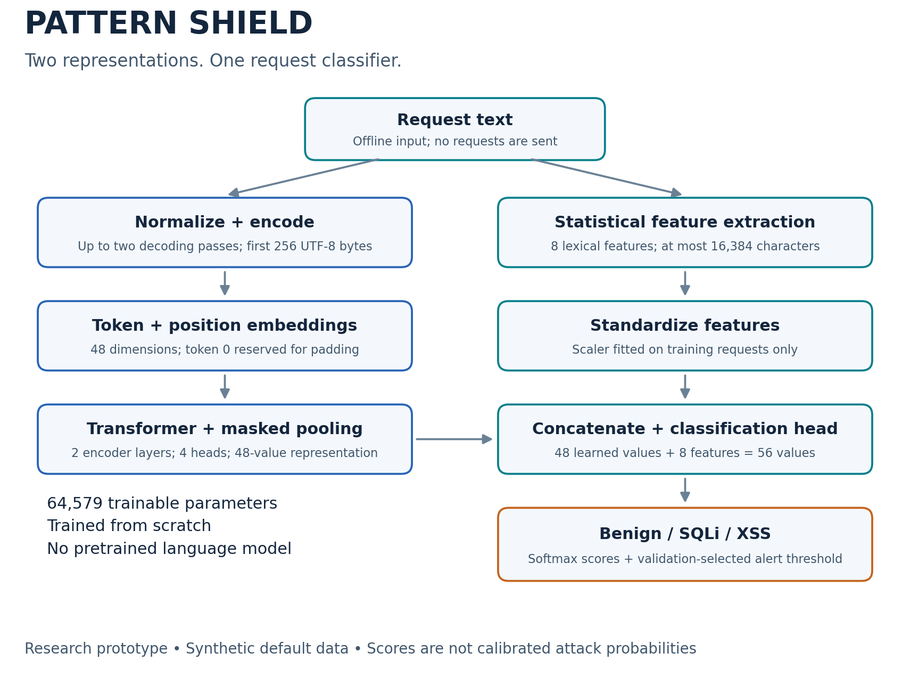
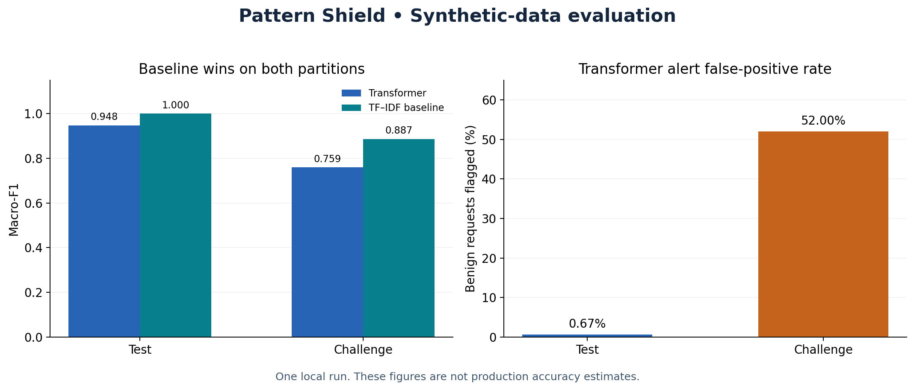
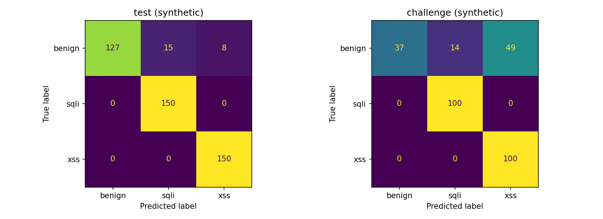
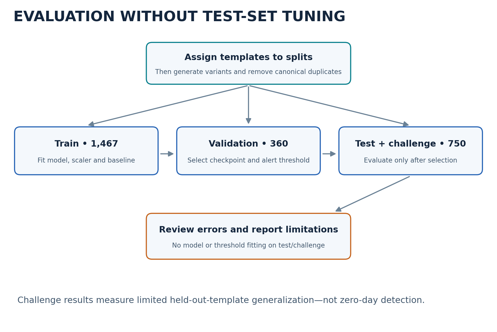

# Pattern Shield
### Transformer-Based Web Request Threat Classification

A reproducible application-security research prototype that classifies HTTP request text as **benign**, **SQL injection**, or **cross-site scripting (XSS)**. Pattern Shield combines a compact byte-level transformer with statistical request features and compares it against a character TF–IDF logistic-regression baseline.

**Colab-ready · PyTorch · 64,579 parameters · Three classes · Reproducible evaluation**

> **Research status:** The included results use synthetic, template-generated request text. This is an offline classification prototype—not a production WAF, an asset-discovery scanner, or a proven zero-day detector. A flagged request is not proof of a vulnerable application.

## Start here

| Goal | Open |
|---|---|
| Run the project in Colab | [Executable notebook](notebooks/Pattern_Shield_Colab.ipynb) |
| Understand every stage | [Technical walkthrough](docs/HOW_IT_WORKS.md) |
| Prepare for an interview | [Interview guide](docs/INTERVIEW_GUIDE.md) |
| Rehearse a five-minute demonstration | [Demo walkthrough](docs/DEMO.md) |
| Inspect evaluation and limitations | [Model card](docs/MODEL_CARD.md) |
| Inspect actual measured results | [Metrics JSON](results/metrics.json) |
| Understand the data and labels | [Data card](data/README.md) |

## What the project implements

- A two-layer transformer encoder trained from scratch over UTF-8 bytes.
- Eight standardized lexical/statistical request features concatenated with the pooled transformer representation.
- Three-way classification and a separate binary alert threshold.
- Train, validation, test and challenge partitions with distinct template groups.
- Canonical deduplication and checks against cross-split group leakage.
- A character n-gram logistic-regression baseline trained on the same training partition.
- Confusion matrices, per-class metrics, macro-F1, alert false-positive rate and attack recall.
- Candidate-alert review, simple per-client/per-minute log aggregation, model serialization and report export.
- Optional labeled CSV input with schema and group checks.

There is no live scanning, HTTP exploitation, production deployment, learned temporal anomaly detector, response analysis or automatic vulnerability confirmation.

## Run in Google Colab

1. Download [Pattern_Shield_Colab.ipynb](notebooks/Pattern_Shield_Colab.ipynb).
2. Open [Google Colab](https://colab.research.google.com/), choose **File → Upload notebook**, and upload it.
3. Optionally select a GPU in **Runtime → Change runtime type**. CPU fallback is automatic.
4. Choose **Runtime → Run all**.
5. Inspect the results and edit the demo request strings.
6. Download the generated **pattern_shield_results.zip** from the Colab Files sidebar.

No model-hosting account, dataset credentials or API keys are needed. The setup cell installs missing dependencies. Runtime files are temporary, so download your results before ending the session.

The included local CPU run took about **29.5 seconds for training**; installation, imports and evaluation add time. Colab runtime, package versions and numerical behavior may differ. This is not a runtime guarantee.

## Run locally

Use Python 3.12 to match the validation environment. Create and activate a virtual environment, then run:

~~~bash
python -m pip install -r requirements.txt
python src/run_pipeline.py
~~~

The script executes the same code cells as the notebook and writes fresh outputs into **pattern_shield_results/**. It does not overwrite the archived **results/** folder.

For an exact record of locally tested versions, see [requirements-tested.txt](requirements-tested.txt). That snapshot includes a CPU-specific PyTorch version; obtaining it may require the PyTorch CPU wheel index. The broad requirements file is the portable starting point.

## How it works

The raw request branches into two representations. Both branches use the same bounded normalization routine; the handcrafted features also retain some raw-encoding information.

~~~mermaid
flowchart TD
    A["Request text"] --> B["Bounded normalization and byte encoding"]
    A --> C["Eight statistical features"]
    B --> D["Token and position embeddings"]
    D --> E["Two transformer encoder layers"]
    E --> F["Masked mean pooling"]
    C --> G["Training-fitted standardization"]
    F --> H["Concatenate representations"]
    G --> H
    H --> I["Three-class prediction"]
    I --> J["Validation-selected alert policy"]
~~~

The model sees up to **256 normalized UTF-8 bytes** per request. Padding is excluded from attention and pooling; batch tails containing only padding are trimmed to reduce computation.

The alert score is **1 − benign softmax score**. The threshold maximizes binary attack F1 on validation data. Softmax scores are **uncalibrated**: they are not reliable real-world probabilities.

See [HOW_IT_WORKS.md](docs/HOW_IT_WORKS.md) for tensor shapes, features, training decisions and an annotated request walkthrough.

## Evaluation: measured results, including failures

These values come from the archived local run, not from a production environment.

| Evaluation split | Requests | Transformer macro-F1 | Baseline macro-F1 | Transformer alert FPR | Transformer attack recall |
|---|---:|---:|---:|---:|---:|
| Test | 450 | 0.9478 | **1.0000** | 0.0067 | 1.0000 |
| Challenge | 300 | 0.7593 | **0.8869** | **0.5200** | 1.0000 |

**The baseline outperformed the transformer on both partitions.** The transformer alert threshold preserved attack recall on the challenge but flagged **52 of 100 benign challenge examples**. That is a substantial failure under distribution shift, not a production-ready result.

Three-class macro-F1 and binary alert metrics are different measurements. The alert policy can flag a request even when the three-class argmax is benign.

The test and challenge examples come from held-out templates. That is a limited generalization test; it does not establish zero-day detection. The same synthetic generator, balanced classes and short requests limit how much can be inferred.

### Evaluation discipline

- The scaler and baseline fit training data only.
- Checkpoint selection uses validation macro-F1.
- Threshold selection uses validation binary F1.
- Test/challenge partitions are evaluated after selection.
- Do not tune using challenge failures and still describe that same challenge as untouched.
- Model weights were saved and reloaded; demo prediction parity passed.

Training history is available as a [CSV](results/training_history.csv) and [image](assets/training_history.png).

## Data

The default corpus contains synthetic requests with independent method/path/parameter sampling and optional percent encoding. Canonical duplicates are removed.

| Split | Benign | SQLi | XSS | Total |
|---|---:|---:|---:|---:|
| Train | 467 | 500 | 500 | 1,467 |
| Validation | 120 | 120 | 120 | 360 |
| Test | 150 | 150 | 150 | 450 |
| Challenge | 100 | 100 | 100 | 300 |

The challenge introduces different SQLi/XSS templates, including timing-style SQLi strings and different HTML event contexts, plus deliberately difficult benign technical text.

For real-data experiments, provide a CSV with **text,label,split,group** and set **DATA_CSV** in the notebook. See the [data card](data/README.md). Do not upload secrets or identifiable customer traffic.

## Saved artifacts

| Folder | Contents |
|---|---|
| notebooks/ | Complete executable Colab notebook with saved local outputs |
| src/ | Python execution script derived from the notebook code cells |
| assets/ | Separate PNG/SVG diagrams and evaluation figures |
| data/ | Synthetic request CSV and data card |
| models/ | Transformer weights, scaler and baseline from the recorded run |
| results/ | Metrics, predictions, training history, provenance and report |
| docs/ | Architecture explanation, model card, demo and interview preparation |

The notebook is the canonical runnable implementation. If its code changes, regenerate the script before claiming the two are identical. The serialized model requires the architecture and preprocessing from the notebook; it is not a standalone service. Load only trusted model/joblib files.

## Limits and next steps

1. **Synthetic data bias:** validate on authorized, representative traffic with independently audited labels.
2. **Context truncation:** implement HTTP-aware parsing and chunking before handling long or multipart requests.
3. **False positives:** investigate difficult benign technical content and choose thresholds using realistic alert budgets.
4. **Calibration:** evaluate and calibrate scores using separate representative validation data.
5. **Evaluation breadth:** separate by application, session, source and time; add near-duplicate checks and uncertainty estimates.
6. **Operational readiness:** benchmark latency, evaluate drift and adversarial robustness, and begin with human-reviewed shadow mode.
7. **Baseline comparison:** improve data and evaluation before increasing neural model complexity.

## Security interpretation

- SQLi findings relate to **CWE-89**; XSS findings relate to **CWE-79**.
- **MITRE ATT&CK T1190** is conditional context for exploitation of public-facing applications. A payload string alone does not establish that technique occurred.
- SQLi remediation includes parameterized queries and least-privilege database accounts.
- XSS remediation includes context-aware output encoding, safe DOM APIs and appropriate sanitization; CSP adds defense in depth.

Pattern Shield supports candidate-alert triage. It does not replace authorized testing, application fixes, established WAF rules or response-context analysis.

## References

- [PyTorch TransformerEncoder](https://docs.pytorch.org/docs/stable/generated/torch.nn.TransformerEncoder.html)
- [Google Colab FAQ](https://research.google.com/colaboratory/faq.html)
- [MITRE ATT&CK T1190](https://attack.mitre.org/techniques/T1190/)
- [CWE-89](https://cwe.mitre.org/data/definitions/89.html)
- [CWE-79](https://cwe.mitre.org/data/definitions/79.html)

Implementation and documentation were developed with AI assistance. The included measurements were produced by executing the notebook locally; no production effectiveness is claimed.

