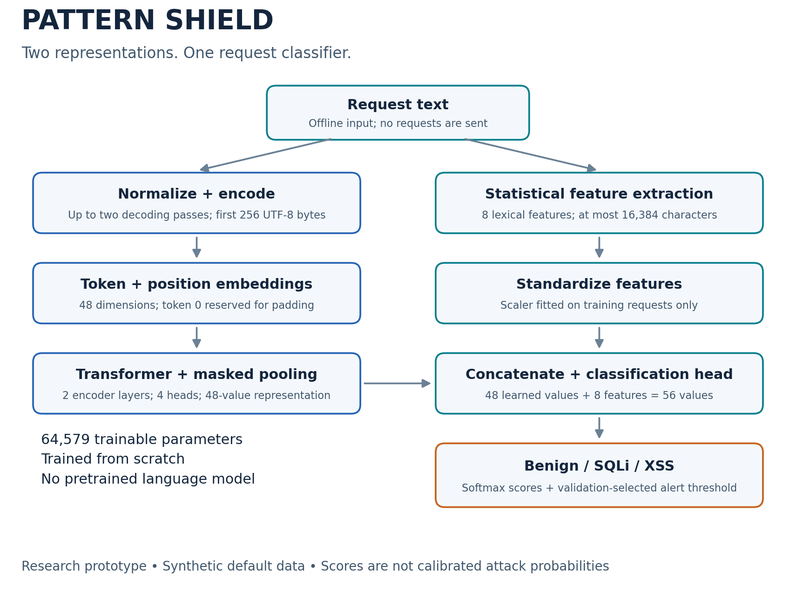

# How Pattern Shield works

## 1. The problem and the unit of analysis

The input is one request-like text string, such as a request line. The output is a class label plus an alert decision. The model is not observing a browser, database, server response, user session or network connection.

For example, a benign search and an injection-like search may have the same HTTP method, endpoint and parameter name. The classifier should learn payload distinctions rather than memorize endpoints. The synthetic generator samples those wrapper fields independently of label.

## 2. Data preparation and leakage controls

The generator defines different payload templates for train, validation, test and challenge. It then substitutes values and optionally percent-encodes the payload. All variants from a template belong to one group and one split.

The CSV schema is **text,label,split,group**. The pipeline checks:
- Required columns and non-missing values.
- Recognized labels and all four partitions.
- No group appears in multiple partitions.
- Canonically identical texts do not have conflicting labels.
- Duplicate normalized texts are retained in train-first partition order.
- Every partition still contains all three classes.

These checks do not discover all semantic near-duplicates. A new random ID can make two examples textually distinct even when they are effectively the same. Real-data evaluation must also consider source, application, session and time.

## 3. Normalization

The routine inspects the first 16,384 characters, then performs at most two rounds of URL-percent decoding and HTML-entity decoding. It preserves letter case and punctuation.

It does not implement full HTTP parsing, Unicode normalization, application-specific decoding or form-urlencoded plus-to-space conversion. Decoding can change the meaning of escaped benign documentation. This is a plausible source of false positives, but no causal feature-ablation study has established the contribution of each preprocessing choice.

The exact same routine is used during training and prediction.

## 4. Byte tokens

The normalized string is UTF-8 encoded, then cut to 256 bytes. Each byte value from 0 to 255 is shifted by one. Token 0 is padding.

For a batch of B requests, tokens initially have shape **B × 256**. The forward pass trims the all-padding tail to the longest non-padding sequence in that batch. This avoids spending attention computation on unnecessary padding without extending the maximum context.

Byte tokens avoid an unknown-word vocabulary but can consume several positions per Unicode character. Cutting at a byte boundary can split a multi-byte character; the model operates on bytes and does not decode that truncated token sequence back into text.

## 5. Feature extraction

| Feature | Definition | Why it may help / caution |
|---|---|---|
| Length | log(1 + inspected raw length) | Coarse structure; length alone is not maliciousness |
| Percent ratio | Percent characters / inspected raw length | Encoding frequency |
| Quote ratio | Single + double quotes / normalized length | Quoting structure; benign names also contain quotes |
| Angle ratio | Opening + closing angle brackets / length | HTML-like syntax; technical articles can be benign |
| Digit ratio | Digit characters / length | Numeric structure |
| Space ratio | Whitespace / length | Token separation |
| Punctuation ratio | Non-alphanumeric, non-whitespace / length | Symbol density |
| Entropy | −Σ p(character) log₂ p(character) | Character diversity; not a security verdict |

A StandardScaler learns each feature's mean and scale from training only. It transforms validation, test, challenge and inference inputs using that fitted state.

## 6. Transformer shapes

| Stage | Shape | Operation |
|---|---|---|
| Tokens | B × L | L ≤ 256 after batch-tail trimming |
| Token embedding | B × L × 48 | 257 vocabulary entries including padding |
| Position embedding | 1 × L × 48 | Learned absolute positions |
| Encoder output | B × L × 48 | Two layers, four heads, 96-wide feed-forward sublayer |
| Masked pooled vector | B × 48 | Mean of non-padding positions |
| Scaled features | B × 8 | Separate statistical branch |
| Concatenated representation | B × 56 | Learned + statistical representation |
| Classification logits | B × 3 | LayerNorm → Linear(56,32) → GELU → Dropout → Linear(32,3) |

Attention uses **softmax(QKᵀ / √dₖ)V**. Each of four heads has a 12-dimensional per-head representation because 48 / 4 = 12. Positional embeddings provide ordering information.

Padding is masked in attention, then excluded from the mean pooling denominator. Encoder matrix weights are initialized independently after layer cloning.

## 7. Training

- Eight epochs, batch size 64, seed 42.
- AdamW with learning rate 0.001 and weight decay 0.01.
- Class-weighted cross-entropy; weight for class c = N / (3 × count(c)).
- Gradient norm clipping at 1.0.
- Dropout of 0.1.
- Best checkpoint selected by validation macro-F1. A tie retains the earlier checkpoint.
- No early stopping, learning-rate scheduler, hyperparameter sweep or pretrained model.

Seeds help reproducibility but do not guarantee bit-identical results across hardware and library versions.

## 8. Baseline

Character TF–IDF features use 2–5 character n-grams, minimum document frequency 2 and at most 20,000 features. A balanced logistic-regression classifier is fitted on training requests.

This is a serious comparator, not a deliberately weak baseline. It outperformed the transformer in the recorded run. A complex architecture needs evidence of benefit, not just an impressive name.

## 9. Prediction and alert policy

The three-class prediction is the largest softmax score. Separately, attack score = 1 − benign score.

The pipeline searches 91 thresholds from 0.05 to 0.95 on validation data and selects the first one achieving the maximum binary F1. Because the candidates are ascending, ties favor the lower threshold.

That choice can favor recall over specificity and does not encode a realistic operational cost model. A benign argmax can coexist with an alert when the threshold is sufficiently low.

The low-confidence flag marks maximum softmax below 0.6. It is a demo heuristic, not a calibrated uncertainty estimate or reliable out-of-distribution detector.

## 10. Evaluation

The confusion matrices assess the three-class argmax. Binary alert FPR and attack recall assess the separate threshold policy.

- Macro-F1 gives each class equal weight.
- Precision measures the fraction of predicted positives that are positive.
- Recall measures the fraction of actual positives recovered.
- FPR measures the fraction of benign examples flagged.

The challenge's **52% benign alert rate** is unacceptable for most real filtering scenarios. The test result cannot be assumed to transfer to a new distribution. The experiment is one seeded synthetic run; it includes no confidence intervals, multi-seed variance, calibration analysis or independent external dataset.

## 11. Behavioral enrichment and triage

The optional log table has timestamp, client, text and path columns. The code scores each request and groups by client and minute. It counts requests, alerts and distinct paths. A review flag is set for at least 20 requests or at least five alerts in a minute.

Those are arbitrary demonstration thresholds. This is rule-based aggregation, not a trained behavior model. A high count is a review signal, not proof of hostile activity.

## 12. Serialization and reproducibility

The pipeline saves weights and configuration, a fitted scaler, the baseline, exact generated data, metrics, predictions and provenance. A SHA-256 digest identifies the generated CSV. A reload check verifies that a fresh model with saved weights reproduces predictions on the demo inputs within numerical tolerance.

The architecture code, preprocessing rules, class order and fitted scaler are all required to reproduce inference. The weights file alone is insufficient. Load only trusted serialized files.

## Explain one request in an interview

1. “I accept the request as text; I do not execute it.”
2. “I apply bounded decoding and extract both byte tokens and statistics.”
3. “The transformer produces a contextual representation of the first 256 bytes.”
4. “I pool non-padding positions and concatenate the eight standardized features.”
5. “The head returns three scores; a separate validation-selected rule decides whether to flag it.”
6. “I investigate the flag with application context. The model has not proved exploitability.”

